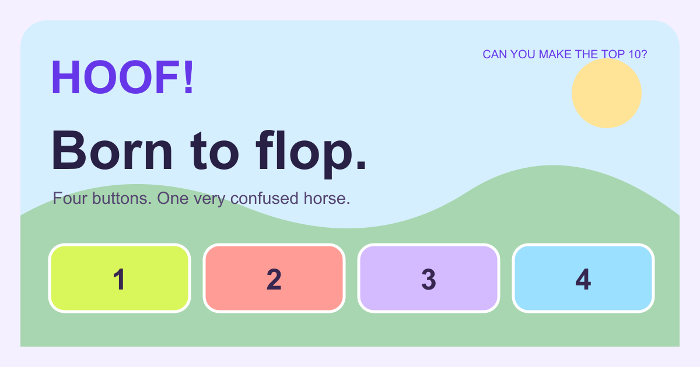

# Clement Arcade

Browser mini-games in Clement’s Gaming Room, with shared leaderboards. No accounts.



Live: https://hoof-game.a2040404.workers.dev/  
Catvolution: https://hoof-game.a2040404.workers.dev/catvolution/

The Worker name is `hoof-game`. Keep that name so the URL stays the same.

## Games

- [HOOF!](https://hoof-game.a2040404.workers.dev/hoof/) — four buttons, one horse
- [Catvolution](https://hoof-game.a2040404.workers.dev/catvolution/) — merge kittens
- [Swim Off!](https://hoof-game.a2040404.workers.dev/frog/) — four-limb swim rhythm
- [Remembrance Flight](https://hoof-game.a2040404.workers.dev/cabin-chaos/) — September 11 memorial
- [TEN.00](https://hoof-game.a2040404.workers.dev/ten-seconds/) — live ten-second timer
- [Itchy Business](https://hoof-game.a2040404.workers.dev/sneaky-scratch/) — stealth scratching
- [Mochi Drop](https://hoof-game.a2040404.workers.dev/mochi-drop/) — drop and merge cats

## Stack

- Games: plain HTML, CSS and JavaScript in `dist/`, no framework
- Server: one Cloudflare Worker (`worker/index.js`); `build.mjs` bundles the game assets into it and it also serves the leaderboard API
- Data: Cloudflare D1, with SQL migrations in `drizzle/`; local development uses SQLite
- Tests: `node:test`, run in CI on every push and pull request

## Local development

Node.js 22.13 or newer. Cloudflare builds use Node 24 (`.node-version`).

```sh
npm install
npm run dev
```

Open http://localhost:4173. Edit the clients under `dist/`, then refresh. The local leaderboard is SQLite in `.local/` and is separate from production.

```sh
npm test
```

`npm test` builds the Worker to `dist/server/index.js`, then runs the tests. `npm run lint` syntax-checks the JavaScript.

## Deploy

From a machine logged into the Cloudflare account that owns Worker `hoof-game` and D1 database `hoof-leaderboard` (`npx wrangler login`, or `CLOUDFLARE_API_TOKEN`):

```sh
npm install
npm run deploy:cloudflare
```

That applies the migrations in `drizzle/`, then deploys. Account and database IDs are already in `wrangler.jsonc`. No API token is stored in this repo. See `CLOUDFLARE.md` if Git builds should publish on push.
